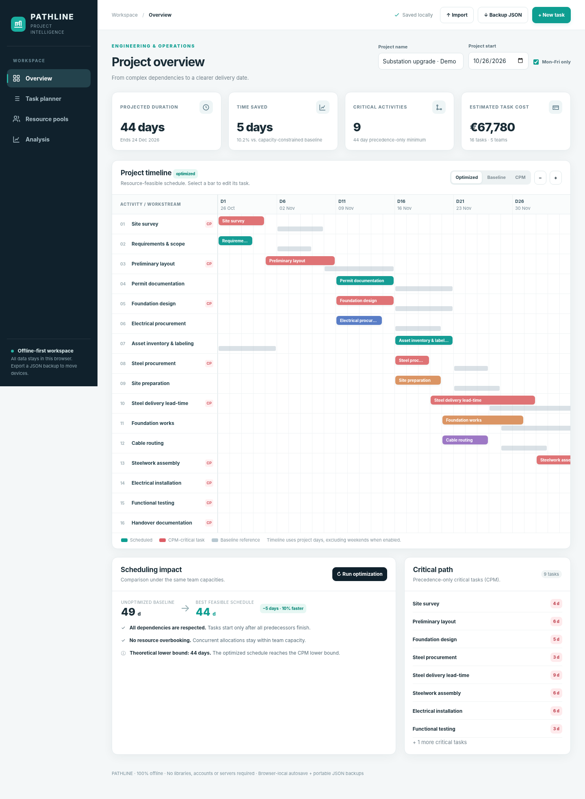

# PATHLINE — Project Scheduling Optimizer

A professional, offline-first, single-file project scheduler for technical and operations projects.

## Run

Open `index.html` in a modern desktop browser. No dependencies, build tools, account, or internet connection required.

For reproducible persistent browser storage across sessions, host the folder on GitHub Pages or run a small local web server (for example, `python -m http.server 8000`) and open `http://localhost:8000`. `file://` storage behavior may vary by browser.

## Features

- Work breakdown structure (tasks, durations, predecessor relationships, notes)
- Finish-to-start dependencies; cycle detection and deletion cleanup
- Critical Path Method: earliest/latest start and finish, total float, longest precedence chain
- Team pools with daily capacity, daily unit rate and editable task allocations
- Capacity-constrained baseline, multi-start heuristic scheduling and comparison
- Interactive Gantt chart, zoom levels, alternative schedules, baseline overlay
- Costs, daily resource utilization, project diagnostics and search
- Business-day or calendar-day scheduling (weekends only; no public holidays)
- Local autosave on every change, plus on tab hide / page exit
- Portable JSON import/export and Excel-friendly CSV schedule export

## Methodology

The scheduler uses **topological ordering** to verify the task graph, then a forward/backward CPM pass. It constructs a feasible serial schedule where each work item starts at the earliest day that follows all predecessors and fits assigned team capacity. Several deterministic/randomized priority rules are searched and the shortest valid makespan is retained. This is a heuristic: **a mathematically globally optimal schedule is not guaranteed**.

Tasks use integer-day durations, a single fixed resource pool with a fixed number of units, and finish-to-start precedence only. Rates are charged per unit-day and do not change with the task's start date. Fixed fees are added separately. Procurement lead-times can be modeled as dummy tasks or tasks allocated to a procurement pool. The CPM baseline ignores resource constraints; the unoptimized baseline respects them. The built-in demo contains 16 tasks and illustrates a baseline of 49 project days, improved by the heuristic to 44 days without violating resource limits.

**Not production-certified**: this is a portfolio and learning tool. Validate planning assumptions independently before using for real contracts.

## Data safety and privacy

All project data stays in the browser, using `localStorage` scoped to the current origin. The browser does not permit arbitrary silent writes to a disk file at closing. Instead the app saves **proactively after every edit**, and attempts an additional save before the page is hidden/closed. Backups export to `.json` via a user action. Clearing site data or switching browsers/domains can erase browser-local storage; export backups for important work.

## GitHub Pages

Upload `index.html` and `README.md` to a repository, then enable *Settings → Pages → Deploy from a branch*. Because there are no external dependencies, it works as a static site.

## License

MIT — see `LICENSE`.

## Demo output

The file [`demo_schedule.csv`](demo_schedule.csv) is an example CSV export from the bundled demonstration project.
